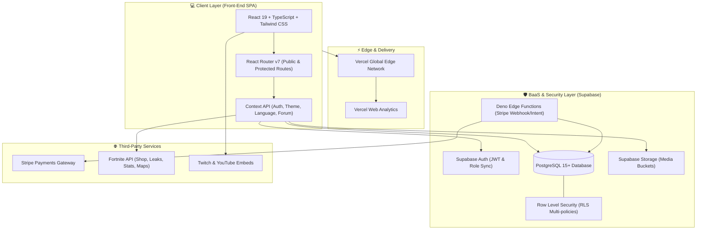

# 🏆 Team BGN Platform - eSports & Community Management (Case Study)

> **Note:** The source code for this project is private due to proprietary business logic. This repository serves as a technical case study highlighting the software architecture, database design, and problem-solving methodologies used to build the platform.

---

## 📌 Executive Summary

The **Team BGN Platform** is a comprehensive solution developed to professionalize, structure, and scale an eSports organization and its gaming community (with a special focus on the competitive **Fortnite** ecosystem).

The ecosystem integrates into a single modern architecture:
1. **Public Player & Fan Portal:** A hub for championships, a public bracket generator (*Easy Brackets*), competitive Elo-based leaderboards, news/item shop central, an internal social network (feed and forum), and a course platform (*BGN Academy*) with Stripe checkout.
2. **Administrative Backoffice & Operational ERP:** A restricted management panel with granular Role-Based Access Control (**RBAC**), a tournament creation engine with automatic brackets, a financial cash flow module, a moderation center, immutable audit logs, and a dynamic CMS for maps, partners, and streamers.

---

  *
*

---

## 🎯 1. The Problem & Market Opportunity

### The Traditional Amateur/Semi-Pro eSports Scenario:
- **Extreme Channel Fragmentation:** Organizations rely on scattered Excel spreadsheets to manage players, chaotic WhatsApp/Discord groups for announcements, and third-party links to build tournament brackets.
- **Lack of Competitive Transparency:** Score tracking, match proofs, and leaderboards are often handled manually, generating distrust regarding fair play and prize distribution.
- **Difficulty Monetizing and Managing Finances:** Absence of native ways to monetize training (courses/coaching), track sponsorships, and monitor the financial balance (prizes paid vs. entry fees and partner revenue).

### The Team BGN Solution:
The platform centralizes all operations into a unified ecosystem, offering a professional-grade experience for players, total autonomy for the organizing committee, and clear metrics for partner brands and sponsors.

---

## 🏗️ 2. Software Architecture & Data Engineering

The solution adopts a **Serverless / Backend-as-a-Service (BaaS)** paradigm, prioritizing high availability, smart operational costs, low latency, and strict data security compliance.

---

## 🎮 3. Public Modules (Player-Facing)

The public portal was designed to delight users with gamer aesthetics, featuring a refined color palette, native dark/light modes, micro-interactions, and instant loading times.

- **Tournament Engine:** Complete registration flows (Solo and Multi-Team), rulebooks, and prize pool breakdowns.
- **Easy Brackets (Public Bracket Generator):** On-demand bracket creator (Single/Double Elimination, Swiss, Round Robin) with PNG export via `html2canvas`.
- **Competitive Leaderboards & Hall of Fame:** Dynamic ranking tables based on competitive Elo with exclusive visual badges.
- **Fortnite Hub:** External API consumption for the Daily Item Shop, cosmetic leaks, and in-game stat tracking.
- **Social Community:** A microblog-style social network (Feed) and a structured thematic Forum with rich text formatting support.
- **BGN Academy:** A digital course platform featuring secure Stripe Elements checkout and a dedicated student area with a video player.

---

  *[ 🖼️ ESPAÇO PARA A FOTO DO DASHBOARD ADMINISTRATIVO/ERP: Arraste e solte a imagem do seu computador aqui ]*

---

## 🛡️ 4. Internal System Modules (Backoffice & Administrative ERP)

Backoffice access is protected by Route Guards that validate the JWT session and the user's permission matrix at runtime.

- **Events & Tournament Central:** Competition creation, registration screening, match management, and automatic team advancement in brackets.
- **Financial Module & Cash Flow Control:** Complete cash ledger with receipt attachments stored in Supabase Storage and balance visualization via Recharts.
- **Staff Management (RBAC):** Role-Based Access Control with 15+ granular atomic permissions (e.g., `manage_finance`, `manage_moderation`).
- **Moderation Center & Audit Trail:** Report management, integrated user banning, and an immutable Audit Log recording IP, user, and action details.
- **Dynamic CMS:** Manager for UEFN creative maps, partner streamers database, and B2B/B2C service catalogs.

---

## 🗄️ 5. Data Modeling & Security (Supabase / PostgreSQL)

The relational database was modeled to ensure referential integrity, high-performance queries, and absolute security isolation through **Row Level Security (RLS)**. Public reads are only allowed for events and leaderboards, while critical tables like `finance_transactions` and `audit_logs` are blocked at the SQL engine level for unauthorized users.

---

## 💡 6. Engineering Challenges & Architectural Solutions

### Challenge 1: Concurrency and Race Conditions in Session Loading
- **Scenario:** On unstable networks, repeated requests to the user profile in Supabase could freeze the UI in loading loops.
- **Solution:** Implemented the `raceWithTimeout` utility and request locks (`fetchLock.current`) using `AbortController`, ensuring duplicate requests are discarded with a secure fallback.

### Challenge 2: Dynamic Bracket Tree with Winner Propagation
- **Scenario:** Eliminatory tournaments require the winner of a match to be automatically promoted to the next round, updating the matchups in real-time.
- **Solution:** Data structuring based on nodes connected via foreign key pointers (`next_match_id`). Upon confirming a score, a trigger/function updates the corresponding slot in the next round.

### Challenge 3: Reliable Purchase Reconciliation in BGN Academy
- **Scenario:** Connection drops in the buyer's browser post-payment could prevent course access from being granted.
- **Solution:** Asynchronous event-driven architecture. Course release does not depend on the front-end: a Supabase Edge Function listens to the `checkout.session.completed` webhook directly from Stripe, validates the signature, and inserts the enrollment with guaranteed idempotency.

---

## 📈 7. Business Impact & Results

- ⚡ **80% Reduction in Operational Time:** Automated bracket generation and check-in control eliminated manual work in external spreadsheets.
- 🎯 **Increased Community Retention:** Players now return daily to check the Fortnite shop, rankings, and interact on the social feed.
- 💰 **Structured Monetization:** Transformed the clan's audience into real revenue through course sales and bulletproof financial management.

---

## 👨‍💻 Author

- **LinkedIn:** [Nicolas Borges](https://www.linkedin.com/in/nicolas-borges-a1b941191/)
- **GitHub:** [@NicolasBorgesDev](https://github.com/NicolasBorgesDev)
- **E-mail:** [niicolasrodriigues2@outlook.com](mailto:niicolasrodriigues2@outlook.com)
